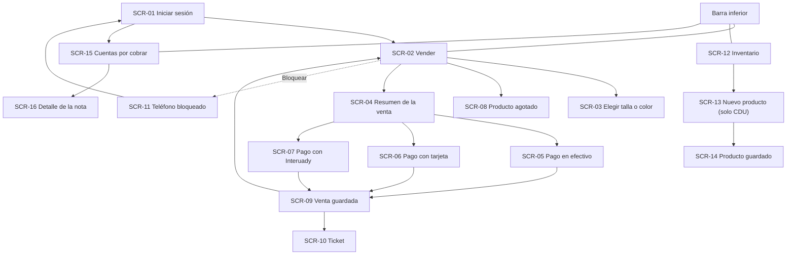

# Design guidelines

> **Task:** T-19 · **Rubric criterion (delivery 2):** 2b · **Status:** v1, applied in [prototype v1](prototype/v1/) — will be revised after the inspection and the usability test.
>
> Rules the interface follows. Each guideline `G-xx` cites where it comes from: a requirement (`FR`, `NFR`), the client (`CR`, `PRJ`), a hypothesis (`H`) or a verified source `[Rn]` in [`references.md`](../docs/references.md). Guidelines that rest only on a hypothesis or on the author's convention say so. Screens are identified as `SCR-xx` in the [screen catalogue](screens.md).

## 1. Information architecture

### 1.1 Destinations per profile

The interface is organized **by what each profile is allowed to do** `[CR-01…CR-04, FR-01]`. A primary persona needs an interface of its own `[R10]`: P-01 gets the shortest one.

| Destination (label in the UI) | Social Sciences / Exact Sciences Campus (P-01) | CDU (P-02) | Central Administration (P-03) | Origin |
|---|---|---|---|---|
| **Vender** — catalog, summary, payment | ✔ **start screen** | ✔ **start screen** | ✔ | CR-01…CR-04, FR-03, FR-13 |
| **Inventario** — inventory per warehouse | — | ✔ with **Nuevo producto** | ✔ read only | CR-01, CR-02, FR-09, FR-10 |
| **Por cobrar** — accounts receivable | ✔ without personal details | ✔ | ✔ **start screen** | CR-14, FR-25, FR-26, H-11 |
| **Bloquear** (top bar, not a destination) | ✔ | ✔ | ✔ | FR-35, NFR-19 |

Central Administration starts on *Por cobrar* because it is expected to query more than it sells `[H-11]`; this changes if H-11 is refuted.

### 1.2 Site map



| ID | Guideline | Origin |
|---|---|---|
| G-01 | Show only the destinations the profile can use; never show a disabled destination. | CR-01…CR-04, FR-01, FR-09 |
| G-02 | At most three destinations in the bottom bar; *Bloquear* lives in the top bar because it is an action, not a place. | Author's convention; FR-35 |
| G-03 | A sale takes at most four levels: catalog → summary → payment → saved. Every level has a visible way back. | NFR-03; heuristic 3, user control and freedom `[R35]` |

### 1.3 Vocabulary

Words in the UI follow the users' language, not internal jargon (heuristic 2 `[R35]`). The client's own terms are kept for institutional concepts.

| Use in the UI | Instead of | Where | Origin |
|---|---|---|---|
| *Guardada en este teléfono. Se enviará sola cuando haya internet.* | sincronización, servidor, modo offline, cola | Status, saved sale | FR-29, NFR-02 |
| *Hay* · *Quedan pocos* · *Agotado* | existencias, stock | Product card | FR-31 (proposal, Q-14) |
| *Cobrar* · *¿Cómo paga?* · *Confirmar venta* | checkout, procesar, transacción | Sales flow | NFR-02 |
| *Interuady*, *C.P. responsable del pago*, *Cuentas por cobrar*, *bodega* | — (kept as the client writes them) | Interuady, Por cobrar, Inventario | CR-13, CR-14, CR-08; meaning of *C.P.* pending (Q-04) |
| *Bloquear* · *Entrar con otra cuenta* | cerrar sesión, logout | Top bar, lock screen | FR-35 |

| ID | Guideline | Origin |
|---|---|---|
| G-04 | No technical terms on the screens used to sell; error messages without codes. | NFR-02, NFR-07; heuristics 2 and 9 `[R35]` |
| G-05 | All UI text in Spanish. The prototype addresses the user as **tú** — *pending the author's confirmation*; how the staff expect to be addressed is not known. | NFR-12 |

## 2. Organization of each screen

### 2.1 Fixed regions

Every screen has the same regions, in the same order (heuristic 4, consistency and standards `[R35]`). The bottom bar appears only on the three top-level screens (*Vender*, *Inventario*, *Por cobrar*); inside a task (a sale, a new product) it is hidden, so the task has one way forward and one way back.

```
┌──────────────────────────────┐
│ Top bar: title · point ·     │  where am I, is my data safe, Bloquear
│ status chip · Bloquear       │
├──────────────────────────────┤
│                              │
│ Content (scrolls)            │  one task per screen
│                              │
├──────────────────────────────┤
│ Action area: one primary     │  lower half, within reach of the thumb
│ button, full width           │
├──────────────────────────────┤
│ Bottom bar: ≤ 3 destinations │  top-level screens only; icon + text label
└──────────────────────────────┘
```

Reference viewport for the low-fidelity prototype: **360 × 640 CSS px**, a small Android phone. This is the author's assumption for a low-end device `[H-02, PRJ-01]`, to be recalibrated when V-05 or Q-12 identify the real devices.

| ID | Guideline | Origin |
|---|---|---|
| G-06 | One task per screen and **one primary action**, full width, in the action area. Secondary actions are text buttons. | NFR-03; heuristic 8 `[R35]` |
| G-07 | Primary actions (add, change quantity, *Cobrar*, *Confirmar venta*) in the **lower half** of the screen, where one thumb reaches. Most observed users held the phone with one hand (49% of 780 touch observations) `[R38]`; the sellers' conditions are a hypothesis `[H-06]`. | NFR-11 |
| G-08 | Touch targets at least **48 × 48 dp** `[R4]`; primary buttons 56 px high. | NFR-09 |
| G-09 | The status chip in the top bar always says, in words, whether everything was sent or how many sales are waiting; it never blocks a sale. | FR-29, NFR-17; heuristic 1, visibility of system status `[R35]` |

### 2.2 Choosing, deciding and confirming

| ID | Guideline | Origin |
|---|---|---|
| G-10 | Products are chosen by **recognition**: a photo card with name and price; the code is shown small. Search by name and scan are alternatives, never requirements. | CR-10, CR-16, FR-14, FR-15; heuristic 6, recognition rather than recall `[R35]` |
| G-11 | **Progressive disclosure:** the fields of a payment method appear only after it is chosen; the three Interuady fields appear only for Interuady. | CR-13, DI-06; `[R36]` |
| G-12 | **Prevent errors before reporting them:** *Confirmar venta* looks disabled until the data is complete, and the screen says how many data are missing. Tapping it anyway highlights the missing fields. | FR-20, NFR-06; heuristic 5, error prevention `[R35]` |
| G-13 | Error messages appear **next to the field**, in plain language, and say what to do next. | NFR-07; heuristic 9 `[R35]` |
| G-14 | Ask for confirmation only for destructive or exceptional actions (remove a line, sell a product recorded as out of stock). Normal actions give feedback instead (*Agregado*). | FR-32, FR-33, DI-23; heuristics 1 and 5 `[R35]` |
| G-15 | Every step has a visible exit: *‹ Seguir agregando*, *Cambiar forma de pago*, *Cancelar*. Nothing is recorded until *Confirmar venta*. | DI-22, FR-22; heuristic 3 `[R35]` |
| G-16 | No mandatory tutorial. A hint appears **once**, at the moment it is needed (e.g. after the first product is added). | NFR-25, DI-26 |

## 3. Components

| Component | Use | Rules | Guidelines |
|---|---|---|---|
| Top bar | Every screen | Screen title; point of sale; status chip; *Bloquear* | G-09 |
| Status chip | Top bar | Text first (*Sin internet · 2 por enviar* / *Todo enviado*); shape changes with state, not only color | G-09, G-21 |
| Product card | SCR-02 | Photo, name, price, small code, availability label; a counter (×2) when it is in the sale | G-10 |
| Bottom sheet | SCR-03 | Choice that belongs to the current screen (size or color); closes with *Cancelar* | G-15 |
| Quantity stepper | SCR-04 | − value +; buttons 48 px; − at 1 asks *¿Quitar…?* | G-08, G-14 |
| Primary button | Action area | Full width, 56 px, one per screen; disabled look keeps the label readable | G-06, G-12 |
| Choice button | SCR-04 | Large stacked buttons for the three payment methods | G-11 |
| Field | Forms | Label above; required data marked; message under the field | G-13 |
| Dialog | Exceptional decisions | States the consequence; destructive option labeled with its verb (*Quitar*, *Agregar de todos modos*) | G-14 |
| Toast | Feedback | Short, disappears; never the only place for important information | G-09 |
| Segmented control | SCR-12 | Warehouse filter (CDU · Sociales · Matemáticas) | G-01 |
| Bottom bar | Global | ≤ 3 destinations, icon **and** text label, current one marked with a bar and bold text | G-02, G-20 |

## 4. Low-fidelity visual conventions

Low fidelity is chosen on purpose: it is fast to change, puts less pressure on test participants and makes clear the work is unfinished `[R39]`.

| ID | Convention | Origin |
|---|---|---|
| G-17 | Grayscale only; no brand, no final icons. | `[R39]`; author's convention |
| G-18 | Product photos are a gray box with an outline drawing of the product type — a stand-in for the real photo `[R39]`. Recognition by real photos is therefore **not** tested with this prototype. | CR-10 |
| G-19 | System font; body text 16 px, titles 20 px, totals 28 px. Author's convention, not taken from a source. | NFR-10 |
| G-20 | Icons are always shown with a visible text label. | NFR-02; `[R37]` |
| G-21 | Color is never the only way to convey state: selection, errors and status also change text, weight, border or shape. | WCAG 2.2 SC 1.4.1 `[R3]` |
| G-22 | Text contrast at least 4.5:1. Measured values of the prototype palette are in §5. | NFR-10; WCAG 2.2 SC 1.4.3 `[R3]` |

## 5. Checks of the prototype against these guidelines

| Check | Result | How |
|---|---|---|
| Contrast of the palette (G-22) | See [prototype README](prototype/v1/README.md#contrast) | Computed with the WCAG formula from the CSS colors |
| Touch targets (G-08) | See [prototype README](prototype/v1/README.md#checks) | Measured in the browser on every interactive element |
| One primary action per screen (G-06) | See [screen catalogue](screens.md) | Design inspection |

The heuristic evaluation (T-22, conditional) and the usability test (T-24) check the guidelines with other evaluators and with participants.

## 6. Decisions left open

| Decision | Depends on | Current choice in the prototype |
|---|---|---|
| Receipt content (VAT breakdown, invoice) | Q-05 | Products, total, payment method, point, seller and time; no VAT line |
| Product code format | Q-08 | Sample codes that imitate the client's example (P010203) |
| Availability label for charge-only profiles | Q-14 | Shown, as a proposal (FR-31) |
| Meaning of *C.P.* and help text for that field | Q-04 | Label exactly as the client wrote it; no help text |
| Personal or shared accounts | Q-11 | Sign-in with user and password; *Entrar con otra cuenta* |
| Stock that Central Administration sells from | Q-02 | CDU stock, provisional |
| List of UADY units for Interuady | DI-08 (client) | Three sample units and *Otra* |
| *Tú* or *usted* | Author | *Tú* |
