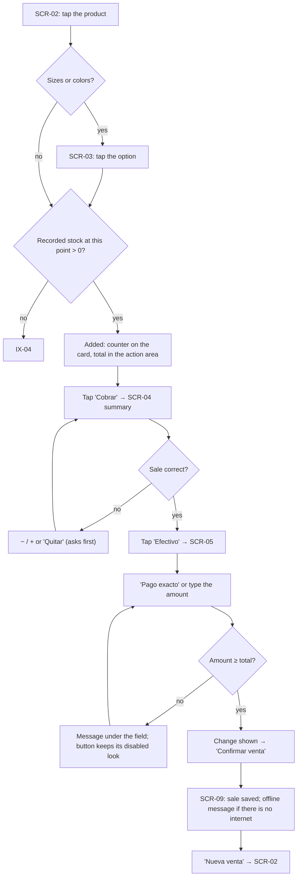
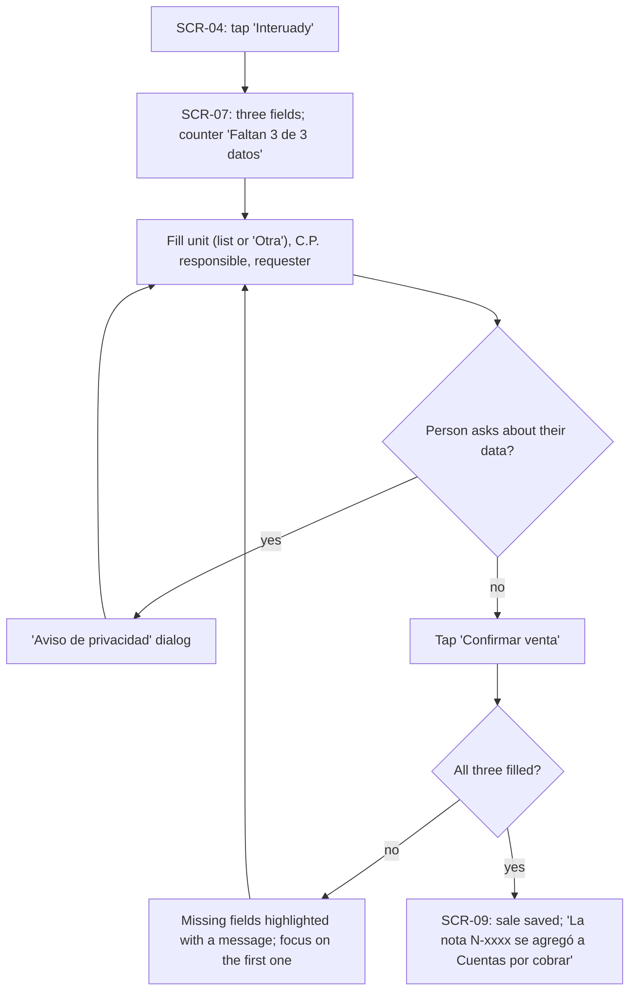
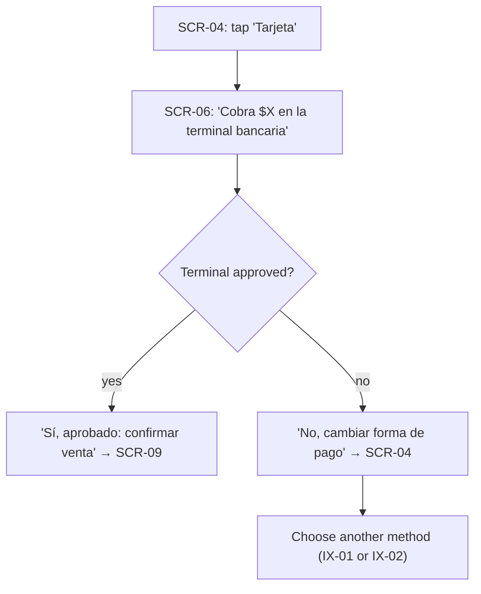
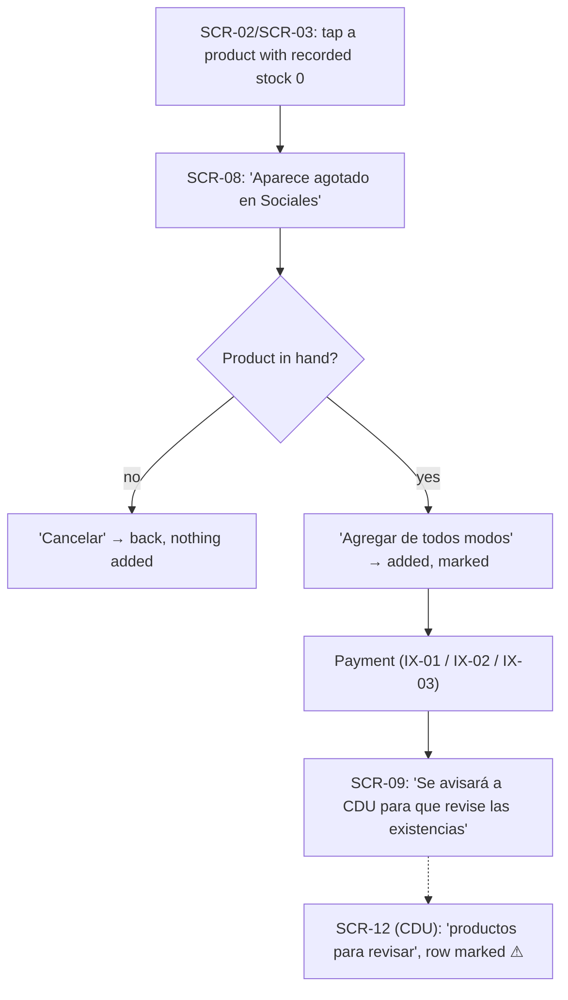
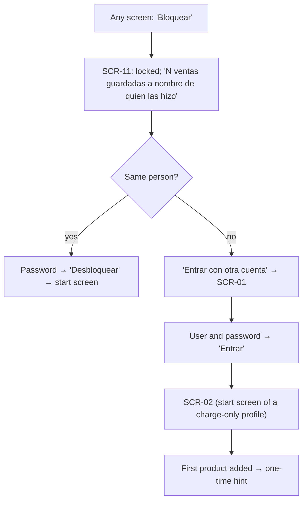
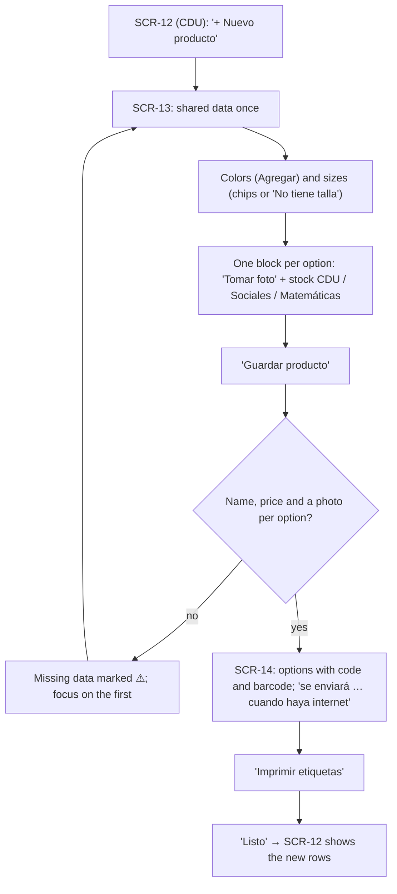
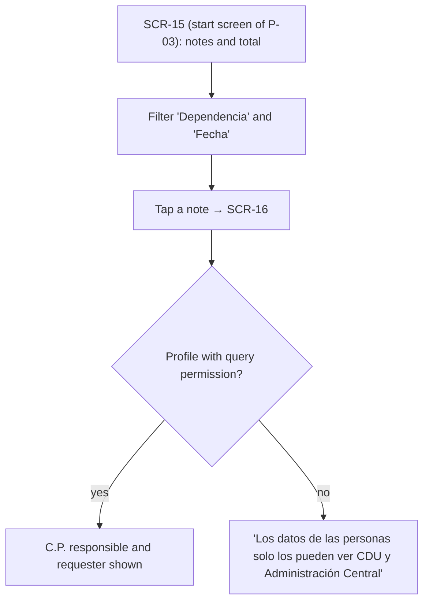

# Interaction design — key interactions

> **Task:** T-21 · **Rubric criterion (delivery 2):** 2d · **Prototype version:** [v1](prototype/v1/)
>
> The key interactions of the system: the essential ones (selling, the daily task of the primary persona) and the most complex ones (Interuady data, out-of-stock sales without internet, products with variants). Each one is specified in the same format, linked to the functional requirements it implements and the usability non-functional requirements it must meet, so it also works as a traceability tool for the NFRs `[rubric 2d]`. [`tools/trace.py`](../tools/trace.py) reads the summary table below and generates the view [requirements → screens → interactions](../docs/04-requirements/traceability-matrix.md#5-requirements--design-screens-and-interactions).

## Format

Every interaction `IX-xx` has four parts:

1. **Essential use case** — a technology-free dialogue in two columns, *user intention* and *system responsibility*, as in usage-centred design `[R40]`. It states what must happen without fixing the interface, so it stays valid if the screens change.
2. **Task flow** — the concrete path through the prototype's screens (`SCR-xx`, [screen catalogue](screens.md)), drawn as a flowchart: rectangles are steps on a screen, diamonds are decisions.
3. **Errors and alternatives** — what can go wrong and how the user recovers.
4. **Usability requirements** — the NFRs the interaction must meet, how the design supports each one, and how it will be measured. These become the tasks of the usability test (T-24).

The interactions rest on the [scenarios](../docs/03-user-modeling/scenarios.md), which are hypothetical: they are revised when field research confirms or refutes the hypotheses behind them.

## Summary

| ID | Interaction | Why key | Persona | Scenarios | Screens | Functional requirements | Usability NFRs |
|---|---|---|---|---|---|---|---|
| IX-01 | Cash sale, correcting the sale before confirming | Essential: the most frequent task of the primary persona | P-01 | S-01, S-07 | SCR-02, SCR-03, SCR-04, SCR-05, SCR-09 | FR-13, FR-16, FR-17, FR-18, FR-22, FR-27, FR-29, FR-33 | NFR-01, NFR-03, NFR-04, NFR-11, NFR-28 |
| IX-02 | Sale paid with Interuady | Most complex sale: three mandatory data, personal data, accounts receivable | P-01 | S-02 | SCR-04, SCR-07, SCR-09 | FR-20, FR-21, FR-24, FR-39 | NFR-06, NFR-07, NFR-22 |
| IX-03 | Card sale, changing the payment method | Essential; must not record card data; recovery when the card is declined | P-01 | S-03 | SCR-04, SCR-06, SCR-09 | FR-17, FR-19, FR-33 | NFR-21, NFR-28 |
| IX-04 | Selling a product recorded as out of stock | Complex: offline data may be behind reality; must not block the sale nor hide the conflict | P-01 | S-05 | SCR-02, SCR-03, SCR-08, SCR-09, SCR-12 | FR-12, FR-22, FR-32 | NFR-07 |
| IX-05 | Shift change on a shared phone | Complex: identity of offline sales; first use without training | P-01 | S-08 | SCR-11, SCR-01, SCR-02 | FR-30, FR-35, FR-38 | NFR-19, NFR-25 |
| IX-06 | Registering a product with colors or sizes | Essential for P-02: every sale depends on this data | P-02 | S-04 | SCR-12, SCR-13, SCR-14 | FR-04, FR-05, FR-06, FR-07, FR-08, FR-34, FR-36 | NFR-26 |
| IX-07 | Finding the Interuady notes of a unit | Essential for P-03; personal data limited by profile | P-03 | S-06 | SCR-15, SCR-16 | FR-25, FR-26 | NFR-20, NFR-27 |

---

## IX-01 — Cash sale, correcting the sale before confirming

**Persona:** P-01 · **Scenarios:** S-01, S-07 · **Screens:** SCR-02 → (SCR-03) → SCR-04 → SCR-05 → SCR-09

**Essential use case**

| User intention | System responsibility |
|---|---|
| 1. Find what the customer wants | Show this point's products, recognizable at a glance, with price and availability |
| 2. Add it (with size or color) | Add it, show the running total |
| 3. Check the sale | Show every line, quantity and the total; allow changing or removing any line |
| 4. Say the customer pays cash, and with how much | Show the change |
| 5. Confirm | Record the sale, deduct the stock of this point, keep it safe on the phone until it can be sent, and say so |
| 6. Start the next sale | Show an empty sale |

**Task flow**

**Errors and alternatives**

| Situation | Design response | Guideline |
|---|---|---|
| Wrong size added (S-07) | Summary before paying; − at 1 or *Quitar* asks *¿Quitar este artículo?*; stock changes only on confirmation | G-14, G-15 |
| Amount lower than the total | *Confirmar venta* keeps its disabled look; tapping it explains the problem under the field | G-12, G-13 |
| No internet | Same flow; the status chip and SCR-09 say the sale is saved on the phone | G-09 |
| First sale of a new seller | One hint after the first product is added, never again | G-16 |

**Usability requirements**

| NFR | How the design supports it | How it is measured |
|---|---|---|
| NFR-01 learnability | Same four steps for every sale; labels in everyday Spanish; no tutorial | First-attempt success after a ≤ 2 min demonstration (V-07) |
| NFR-03 efficiency | One-item cash sale in **5 taps** in v1 (product, *Cobrar*, *Efectivo*, *Pago exacto*, *Confirmar venta*) | Counted by [`flows.js`](../tools/prototype/flows.js); target ≤ 5 |
| NFR-04 efficiency | Same as NFR-03; the baseline needs V-01 (blocked) | Time per sale vs. baseline (delivery 3) |
| NFR-11 one hand | *Cobrar*, stepper and *Confirmar venta* in the lower half | Design inspection |
| NFR-28 errors | Summary and confirmation of removals | Errors per task (V-07) |

---

## IX-02 — Sale paid with Interuady

**Persona:** P-01 · **Scenario:** S-02 · **Screens:** steps 1–3 of IX-01, then SCR-04 → SCR-07 → SCR-09

**Essential use case**

| User intention | System responsibility |
|---|---|
| 1. Put together the sale (IX-01, steps 1–3) | As in IX-01 |
| 2. Say the customer pays with Interuady | Ask for the three data the client requires; offer the privacy notice for the person giving them |
| 3. Provide the data | Say how many data are still missing |
| 4. Confirm | If anything is missing, point to it and record nothing; otherwise record the sale and create the accounts receivable note, and say so |

**Task flow**

**Errors and alternatives**

| Situation | Design response | Guideline |
|---|---|---|
| A field is empty | Counter before confirming; on tapping, highlight and message under each missing field, focus on the first | G-12, G-13 |
| The unit is not in the list | *Otra* shows a text field (the real list depends on the client, DI-08) | G-11 |
| Wrong payment method chosen | *‹ Cambiar forma de pago* returns to the summary; nothing is recorded | G-15 |
| The seller does not know what *C.P.* means | Not solved in v1: the label is kept as the client wrote it until Q-04 is answered | — |

**Usability requirements**

| NFR | How the design supports it | How it is measured |
|---|---|---|
| NFR-06 errors (prevention) | Fields shown only for Interuady; counter of missing data; confirmation blocked until complete | ≥ 80% complete without a validation error; 100% identify the missing field (V-07, S-02) |
| NFR-07 errors (recovery) | Each message names the field and says what to write | Heuristic inspection |
| NFR-22 privacy | Privacy notice reachable from the form; only the three client fields are collected | Checklist (NFR-22) |

---

## IX-03 — Card sale, changing the payment method

**Persona:** P-01 · **Scenario:** S-03 · **Screens:** SCR-04 → SCR-06 → SCR-09, or back to SCR-04

**Essential use case**

| User intention | System responsibility |
|---|---|
| 1. Say the customer pays by card | Tell the seller to charge the amount on the bank terminal; ask for no card data |
| 2a. Report that the terminal approved it | Record the sale as paid by card |
| 2b. Report that it was declined | Go back to the payment choice; record nothing |

**Task flow**

**Errors and alternatives:** card declined → back to SCR-04 with the sale intact (G-15). A separate terminal is a hypothesis (H-10, Q-06); if the client requires integration, this interaction changes (FR-D4).

**Usability requirements**

| NFR | How the design supports it | How it is measured |
|---|---|---|
| NFR-21 no card data | No card field exists; the screen says so | Data model review |
| NFR-28 errors | Both outcomes are explicit buttons; the declined path records nothing | Errors per task (V-07, S-03) |

---

## IX-04 — Selling a product recorded as out of stock

**Persona:** P-01 · **Scenario:** S-05 · **Screens:** SCR-02/SCR-03 → SCR-08 → … → SCR-09; CDU sees the result in SCR-12

**Essential use case**

| User intention | System responsibility |
|---|---|
| 1. Add a product that this phone records as out of stock | Warn, explain the consequence, offer to sell anyway or cancel |
| 2. Decide to sell it (the product is in hand) | Add it and mark it for review |
| 3. Complete the sale (IX-01, IX-02 or IX-03) | Record the sale, say that CDU will review the stock, and show the case to CDU without correcting it silently |

**Task flow**

**Usability requirements**

| NFR | How the design supports it | How it is measured |
|---|---|---|
| NFR-07 errors (recovery) | The dialog explains what happened and what each option does; the destructive option is labeled with its verb | Heuristic inspection |

---

## IX-05 — Shift change on a shared phone

**Persona:** P-01 · **Scenario:** S-08 · **Screens:** SCR-11 → SCR-01 → SCR-02

**Essential use case**

| User intention | System responsibility |
|---|---|
| 1. (Outgoing seller) Leave the phone | Lock it in one action; keep unsent sales under the name of the person who made them |
| 2. (Incoming seller) Identify themselves | Sign in, also without internet after the first sign-in on the phone |
| 3. Start selling without training | Open on the sales screen; give one hint at the moment it is needed |

**Task flow**

**Errors and alternatives:** empty user or password → message under the field (G-13). Whether accounts are personal or one per point depends on Q-11; the lock time on inactivity is to be confirmed (NFR-19).

**Usability requirements**

| NFR | How the design supports it | How it is measured |
|---|---|---|
| NFR-19 security | One tap to lock; unlocking is one field and one button | Functional test |
| NFR-25 learnability | No tutorial; one contextual hint | Design inspection; V-07 |

---

## IX-06 — Registering a product with colors or sizes

**Persona:** P-02 · **Scenario:** S-04 · **Screens:** SCR-12 → SCR-13 → SCR-14 → SCR-12

**Essential use case**

| User intention | System responsibility |
|---|---|
| 1. Start a new product | Ask for the shared data once |
| 2. Give name, type, supplier, net cost and sale price | — |
| 3. List the colors and sizes | Create one option per color and size, and show them |
| 4. Add a photo and initial stock per warehouse for each option | — |
| 5. Save | Check that nothing required is missing; create a code and barcode per option; make them available at the points at the next connection |
| 6. Print the labels | Send them to the printer |

**Task flow**

**Usability requirements**

| NFR | How the design supports it | How it is measured |
|---|---|---|
| NFR-26 efficiency | Shared data once; options generated from colors × sizes; stock for the three warehouses in the same block | Median time per product (V-07, S-04) |

---

## IX-07 — Finding the Interuady notes of a unit

**Persona:** P-03 · **Scenario:** S-06 · **Screens:** SCR-15 → SCR-16

**Essential use case**

| User intention | System responsibility |
|---|---|
| 1. See what other units owe | List the Interuady notes with unit, amount, date and point, and the total |
| 2. Narrow to one unit or period | Filter and update the total |
| 3. Check a note | Show its products and amounts; show the people's data only to profiles with query permission |

**Task flow**

**Errors and alternatives:** no notes for the filters → *No hay notas con estos filtros*. A status filter (pending / paid) is added when settlement is defined (FR-D5, Q-09).

**Usability requirements**

| NFR | How the design supports it | How it is measured |
|---|---|---|
| NFR-27 efficiency | Start screen for P-03; two filters; total always visible | ≥ 80% succeed in ≤ 1 min (V-07, S-06) |
| NFR-20 privacy | Personal data hidden by profile in the detail | Local storage inspection (V-08) |
