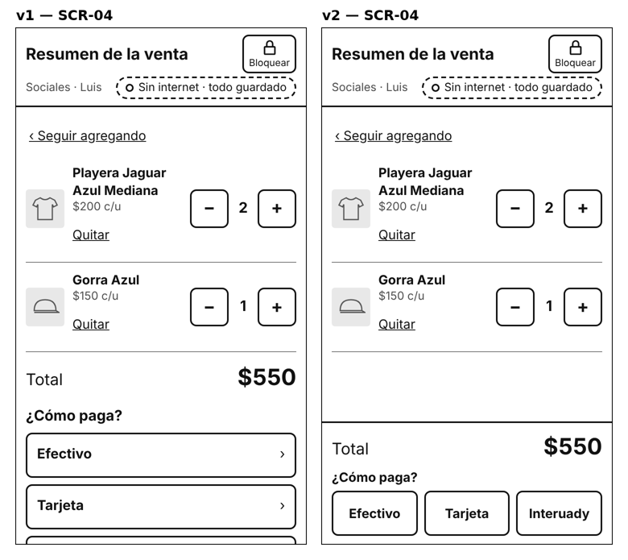

# Prototype evolution

> **Task:** T-23 · **Rubric criterion (delivery 2):** 2c · **Versions:** [v1](prototype/v1/) (2026-10-29) → [v2](prototype/v2/) (2026-10-31, current)
>
> How the interface design changed between versions, why, and what was decided not to change. Every version is kept in its own folder, so both can be opened and compared. Delivery 3 adds the versions that come out of the usability tests.

## Timeline

| Version | Date | Built from | Reviewed by | What it was checked with |
|---|---|---|---|---|
| **v1** | 2026-10-29 | Proto-personas P-01…P-03, scenarios S-01…S-08, requirements, [design guidelines](guidelines.md) | The author on a computer (2026-10-29) and on an iPhone 14 Pro Max (2026-10-30) | Automated flows (39 assertions), touch targets, contrast, screenshots at 360 × 640 |
| **v2** | 2026-10-31 | v1 + the issues noticed while building and testing it (B-1…B-3) | The author decided which issues to fix | The same checks, plus the paths of the seven test tasks (11 checks) |

No usability test with participants has been run yet, so **no change comes from users**; the inspection (T-22) was cancelled. The changes come from the AI assistant's review of the v1 screenshots and from the author's test on a real phone.

## Changes v1 → v2

| Issue | Found by | Screen | Problem in v1 | Decision | Change in v2 | Guideline |
|---|---|---|---|---|---|---|
| **B-1** | AI assistant, v1 screenshots at 360 × 640 (2026-10-29) | SCR-04 *Resumen de la venta* | With two products in the sale, *Interuady* — the third payment method — is below the visible area of a small phone; the seller has to scroll to find it and may not know it exists. It did not appear on the author's larger iPhone screen. | **Changed** (author, 2026-10-31) | The total and the three payment methods move to the action area at the bottom, side by side, always visible; the list of products scrolls above them | G-06, G-07 |
| **B-2** | AI assistant, v1 screenshots (2026-10-29) | Top bar of SCR-02, SCR-09, SCR-11, SCR-15 | *Sin internet · 2 ventas por enviar* is long, so the point and user wrap to two lines | **Not changed** (author, 2026-10-31): the full wording is clearer for new users who are not familiar with the app; the extra line is acceptable | — | G-04, G-09 |
| **B-3** | Author, iPhone test (2026-10-30) | SCR-05, SCR-07, SCR-13 | The keyboard covers the primary button while typing | **Not changed** (author, 2026-10-30): the page can be scrolled or the keyboard closed | — | G-07 |
| — | Question from the assistant (2026-10-29) | SCR-15 start screen | Central Administration starts on *Por cobrar* (H-11) | No change requested by the author | — | G-01 |

## What stays open for the next versions

- Recognition by real product photos (CR-10): v1 and v2 use drawings `[R39]`.
- The client's terms *Interuady* and *C.P.*: the author, a UADY student, did not know them (2026-10-29); the test's closing interview asks participants about them.
- Everything that depends on open questions Q-01…Q-17 ([design guidelines §6](guidelines.md#6-decisions-left-open)).
