# Low-fidelity prototype — version 1

> **Task:** T-20 · **Rubric criterion (delivery 2):** 2a · **Built:** 2026-10-29 by the AI assistant from the author's instructions · **Author's review:** pending (checkpoint A of the [schedule](../../../docs/00-management/schedule.md#5-delivery-2--plan-due-2026-10-31))
>
> Clickable, low-fidelity prototype of the point of sale. It follows the [design guidelines](../../guidelines.md) and implements the screens of the [screen catalogue](../../screens.md). It is built from the [proto-personas](../../../docs/03-user-modeling/proto-personas.md) and [scenarios](../../../docs/03-user-modeling/scenarios.md), which are **hypotheses** (no field research yet); every design choice that rests on a hypothesis cites it.

## How to open it

| What | How |
|---|---|
| Use it as a participant would | Open [`index.html`](index.html) in a browser (phone or computer). It is one file with no external resources, so it also works without internet once downloaded. |
| Facilitator panel (choose profile, internet on/off, printer, scanner, jump to any screen) | Add `?f` to the address: `index.html?f`. Participants do not see the panel unless the address has `?f`. |
| Annotations (screen ID, requirements and pending questions on every screen) | `index.html?f&notas`, or tick *Anotaciones* in the panel. |
| Sign in | Any user and password. The users `luis`, `daniela` and `martha` open the profiles of P-01 (Campus Sociales), P-02 (CDU) and P-03 (Central Administration); any other user opens the profile chosen in the facilitator panel (default: Campus Sociales). |

The UI text is in Spanish `[NFR-12]`; the code and comments are in English.

## Scope

| Included | Proto-persona | Scenarios | Key interactions |
|---|---|---|---|
| Sign in, lock and change user | All | S-08 | IX-05 |
| Sale by photo, search or scan; sizes and colors; summary with corrections | P-01 (also P-02, P-03) | S-01, S-03, S-07 | IX-01 |
| Cash, card and Interuady payment; sale saved without internet; ticket on screen | P-01 | S-01, S-02, S-03 | IX-01, IX-02, IX-03 |
| Selling a product recorded as out of stock | P-01 | S-05 | IX-04 |
| Inventory per warehouse with items to review; new product with variants | P-02 | S-04, S-05 | IX-06 |
| Accounts receivable with filters; note detail by profile | P-03 (also P-01, P-02) | S-06 | IX-07 |

**Not included in v1:** desktop layout of the query views (FR-37, *Could*); editing an existing product (FR-09 covers it; only creation is prototyped); deferred requirements FR-D1…FR-D6. Requirements without a screen are listed in the [screen catalogue](../../screens.md#requirements-not-in-prototype-v1).

**Simulated, not real:** internet and synchronization (switched in the facilitator panel), the printer, the barcode scanner and the camera, the photos (drawings). Reloading the page resets all data.

**Sample data.** Products, prices, stock, notes, units and people are **fictional**, written for the prototype, except the record `P010203` *Playera Jaguar Azul, Mediana, $100.00 / $200.00, Spiro, 100 at CDU*, which comes from the [client's document](../../../client/client-requirements.md#inventory). The UADY units in the Interuady list are examples; the real list depends on the client (DI-08).

## Screens

Captured at 360 × 640 CSS px (the reference viewport, [G-07](../../guidelines.md#21-fixed-regions)) in the sample state of each screen; *full* shows the whole scrollable content.

| | | | |
|---|---|---|---|
| **SCR-01** Iniciar sesión 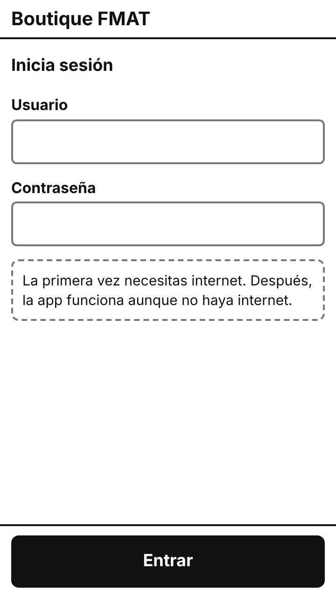 | **SCR-02** Vender ([full](screens/SCR-02-full.png)) 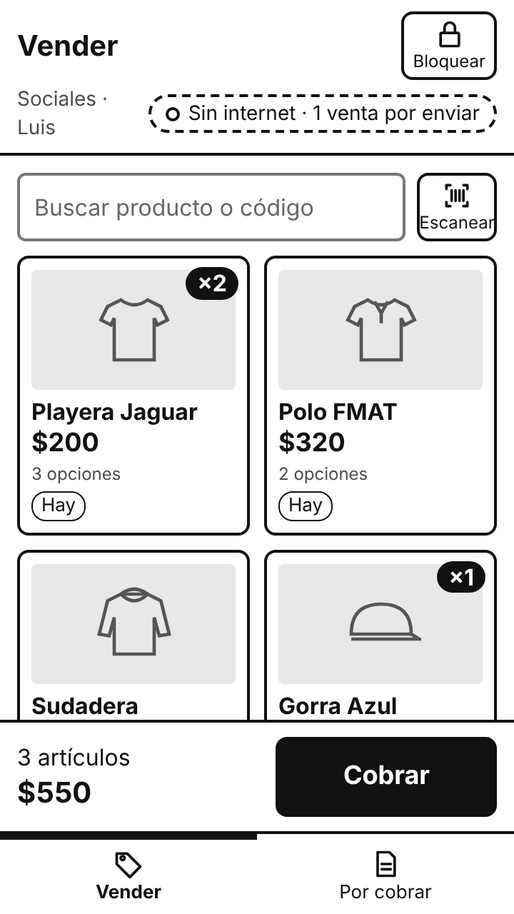 | **SCR-03** Elegir talla o color 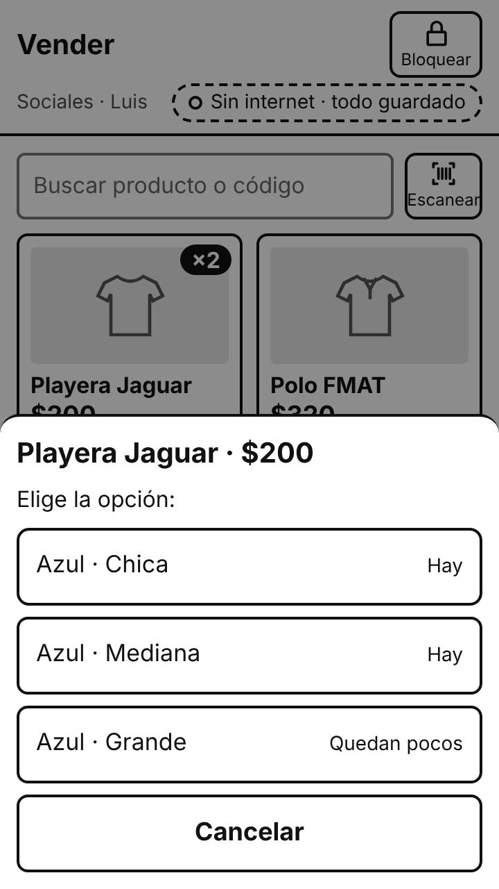 | **SCR-04** Resumen de la venta ([full](screens/SCR-04-full.png)) 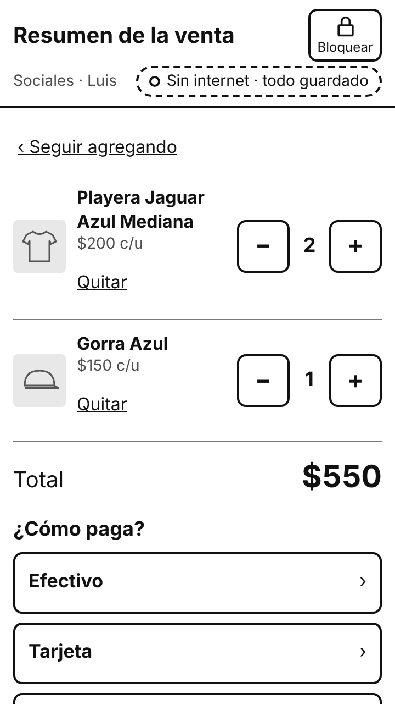 |
| **SCR-05** Pago en efectivo 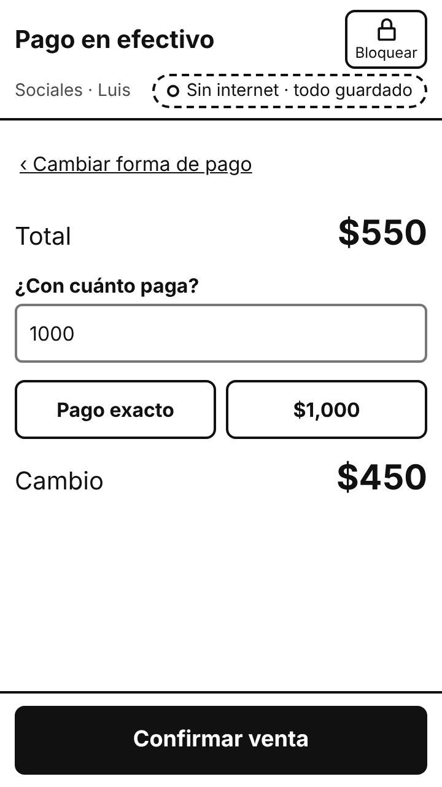 | **SCR-06** Pago con tarjeta 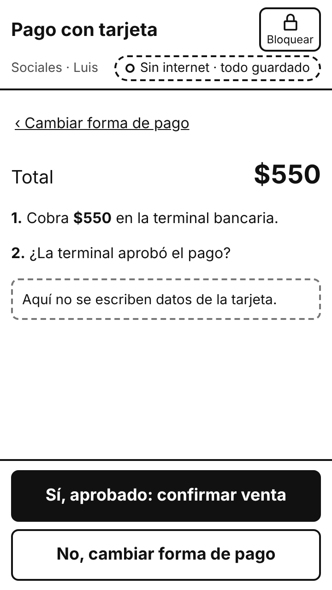 | **SCR-07** Pago con Interuady ([full](screens/SCR-07-full.png)) 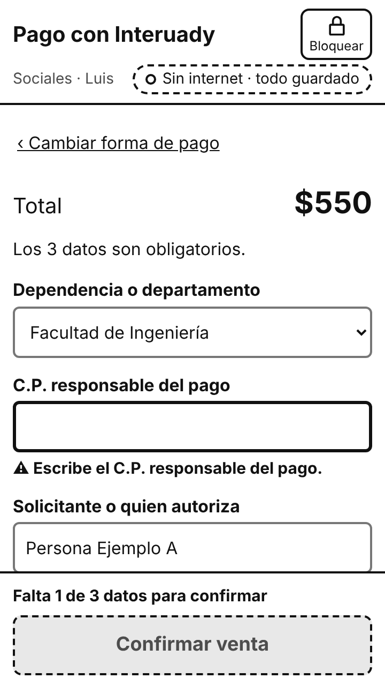 | **SCR-08** Producto agotado 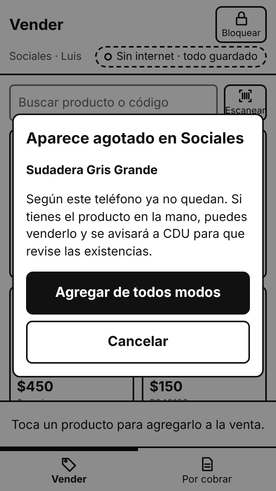 |
| **SCR-09** Venta guardada 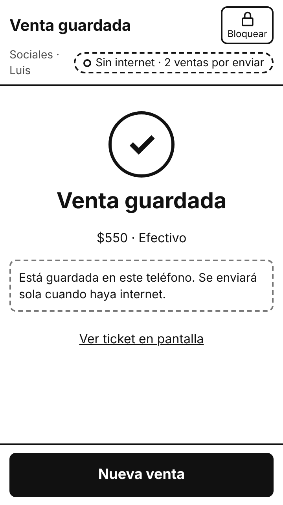 | **SCR-10** Ticket 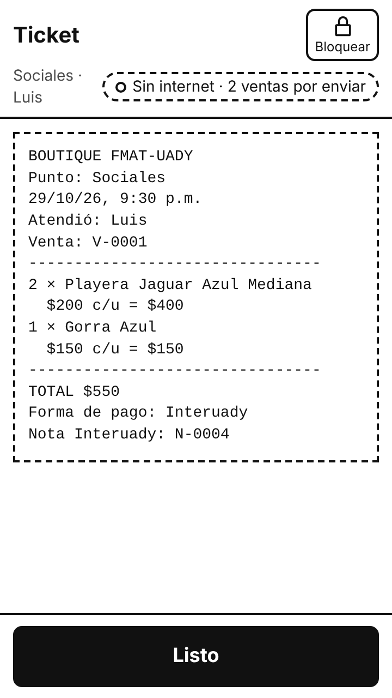 | **SCR-11** Teléfono bloqueado 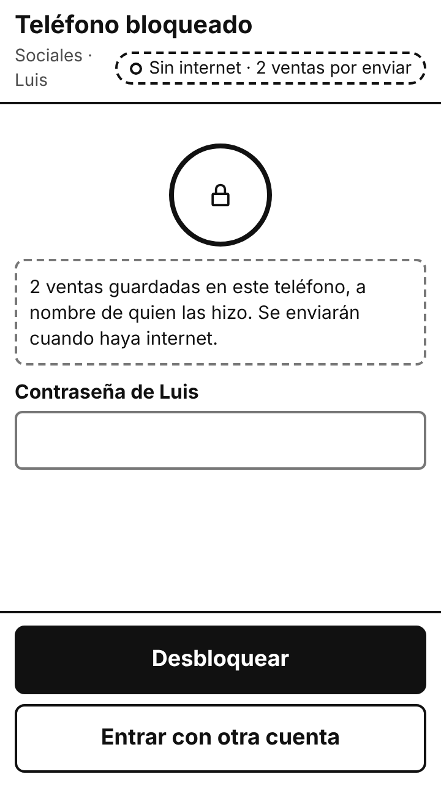 | **SCR-12** Inventario ([full](screens/SCR-12-full.png)) 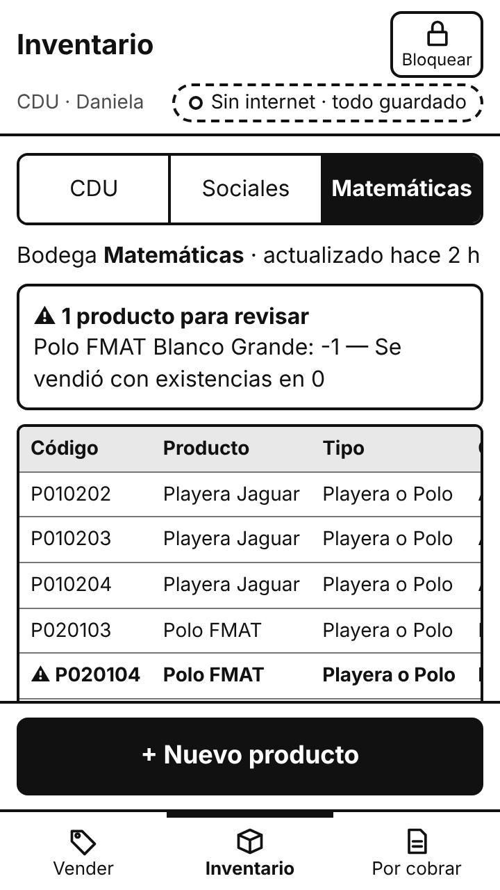 |
| **SCR-13** Nuevo producto ([full](screens/SCR-13-full.png)) 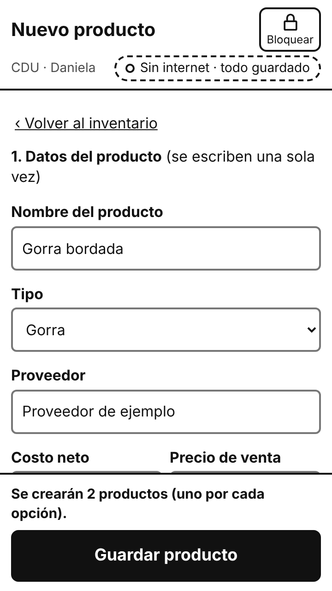 | **SCR-14** Producto guardado ([full](screens/SCR-14-full.png)) 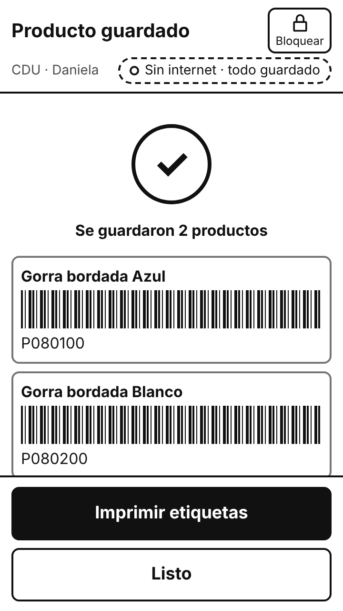 | **SCR-15** Cuentas por cobrar 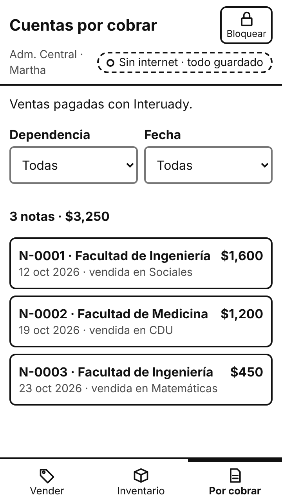 | **SCR-16** Detalle de la nota 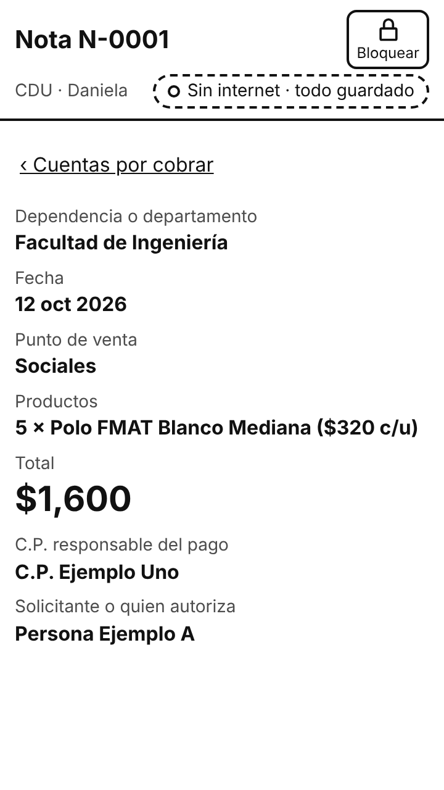 |

## Checks

Run by the AI assistant on 2026-10-29 in a headless Chromium browser (Playwright) at 360 × 640. They check that the prototype works and follows the guidelines; they are **not** a usability evaluation.

| Check | Result |
|---|---|
| Key flows clicked end to end (sign-in validation; cash, card and Interuady sale; corrections; out of stock; privacy notice; ticket; lock and change user; new product with variants and missing photos; accounts receivable by profile; navigation per profile) | 39 of 39 assertions pass; no script errors. Script: [`tools/prototype/flows.js`](../../../tools/prototype/flows.js) |
| One-item cash sale | 5 taps: product → *Cobrar* → *Efectivo* → *Pago exacto* → *Confirmar venta* (NFR-03 target: ≤ 5) |
| Touch targets ([G-08](../../guidelines.md#21-fixed-regions)) | 0 buttons, fields or selectors smaller than 48 px on any of the 16 screens |
| Screenshots | [`tools/prototype/shots.js`](../../../tools/prototype/shots.js), then converted to grayscale PNG with Pillow |

### Contrast

Computed with the WCAG 2.2 relative-luminance formula from the CSS colors ([G-22](../../guidelines.md#4-low-fidelity-visual-conventions), NFR-10: ≥ 4.5:1 for text).

| Use | Colors | Ratio |
|---|---|---|
| Body text, titles | `#111111` on `#ffffff` | 18.9:1 |
| Secondary text | `#4d4d4d` on `#ffffff` | 8.5:1 |
| Placeholder text | `#666666` on `#ffffff` | 5.7:1 |
| Primary button, selected chip, selected segment | `#ffffff` on `#111111` | 18.9:1 |
| Label of a button that looks disabled | `#4d4d4d` on `#e8e8e8` | 6.9:1 |
| Table header | `#111111` on `#e8e8e8` | 15.4:1 |
| Product drawing (graphic, not text) | `#555555` on `#e8e8e8` | 6.1:1 |

## Issues noticed while building v1

Found by the AI assistant when reviewing the screenshots; candidates for v2 (T-23), to be confirmed by the author and the inspection.

| # | Screen | Issue | Guideline |
|---|---|---|---|
| B-1 | SCR-04 | At 360 × 640, with two lines in the sale, *Interuady* — the third payment method — is below the fold; the seller has to scroll to see it. | G-06, G-07 |
| B-2 | SCR-02, SCR-09, SCR-11, SCR-15 | When the status chip is long (*Sin internet · 2 ventas por enviar*), the point and user wrap to two lines in the top bar. | G-09 |

## Limitations for testing

- Products are recognized by **drawings**, not photos, so recognition by photo (CR-10) is not tested with this version `[R39]`.
- Low fidelity may leave participants unsure of what is supposed to work `[R39]`; the test protocol (T-24) tells them what is simulated.
- Times measured with this prototype are not comparable with real sales (see the [validation plan](../../../docs/02-research/validation-plan.md#3-data-to-collect-and-analysis)).
