# Low-fidelity prototype — version 2 (current)

> **Task:** T-23 · **Rubric criteria (delivery 2):** 2a, 2c · **Built:** 2026-10-31 · **Online:** https://alambrep.github.io/boutique-fmat-pos/design/prototype/v2/
>
> Version 1 with one change: issue **B-1** fixed in SCR-04 (the payment methods are always visible at the bottom). Why this changed and what did not change: [prototype evolution](../../prototype-evolution.md). Everything else — how to open it, scope, sample data, simulated parts, limitations — is as described for [v1](../v1/README.md).

## How to open it

Same as [v1](../v1/README.md#how-to-open-it): open [`index.html`](index.html) or the online link above; add `?f` for the facilitator panel and `?f&notas` for the annotations.

## Screens

Captured at 360 × 640 CSS px, in the same sample states as v1. Only SCR-04 differs from v1.

| | | | |
|---|---|---|---|
| **SCR-01** 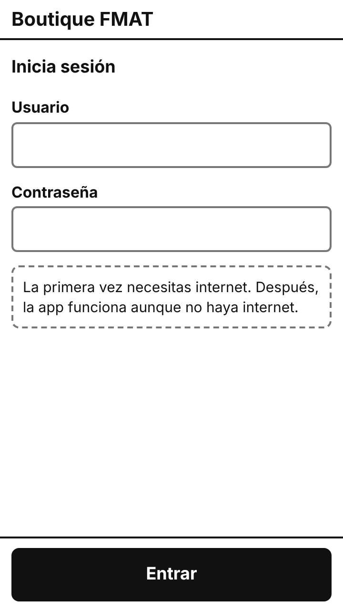 | **SCR-02** ([full](screens/SCR-02-full.png)) 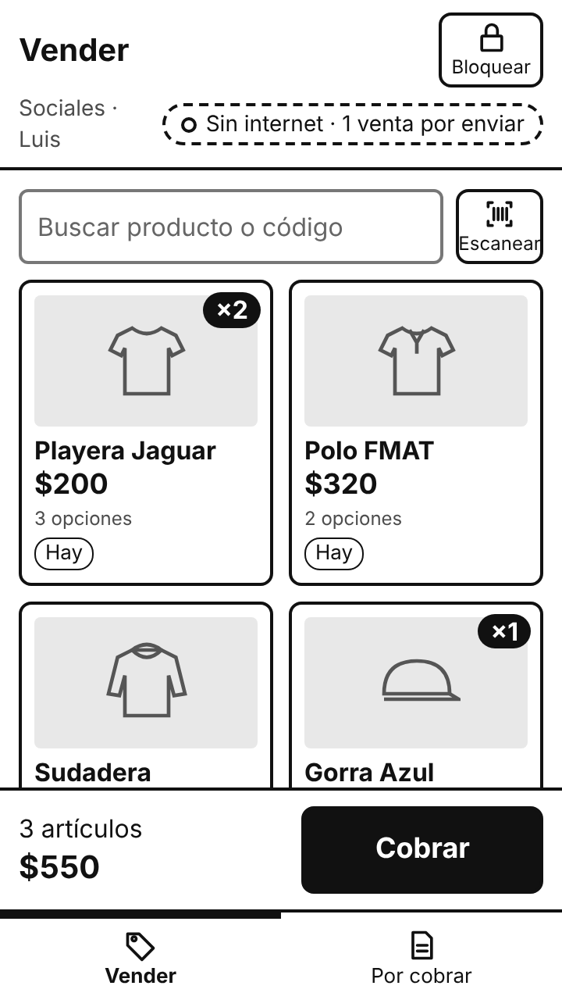 | **SCR-03** 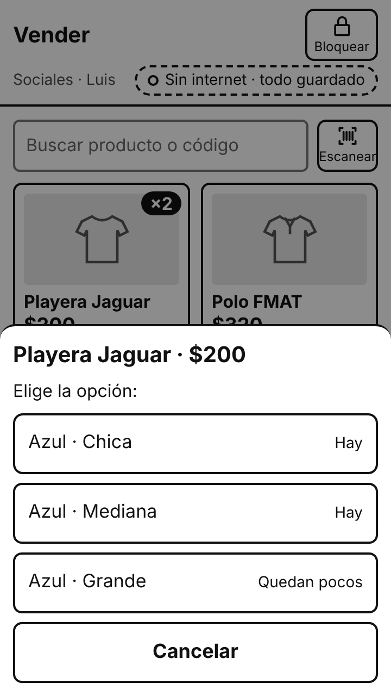 | **SCR-04** — changed 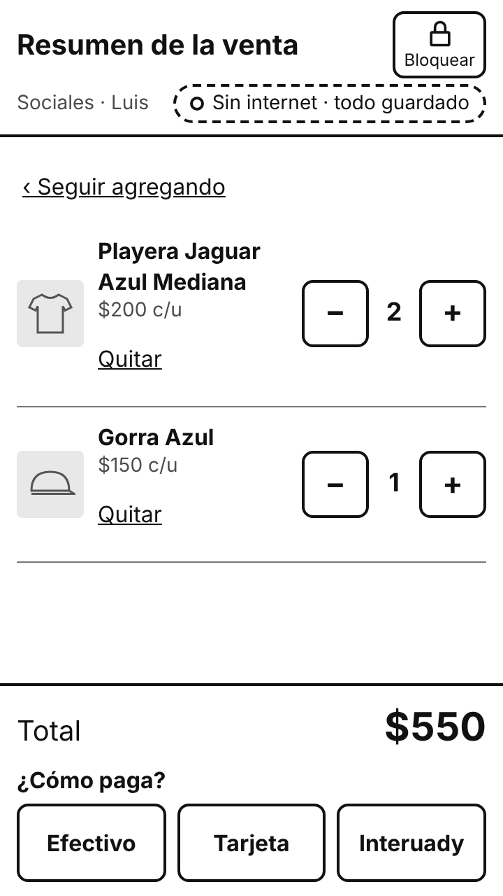 |
| **SCR-05** 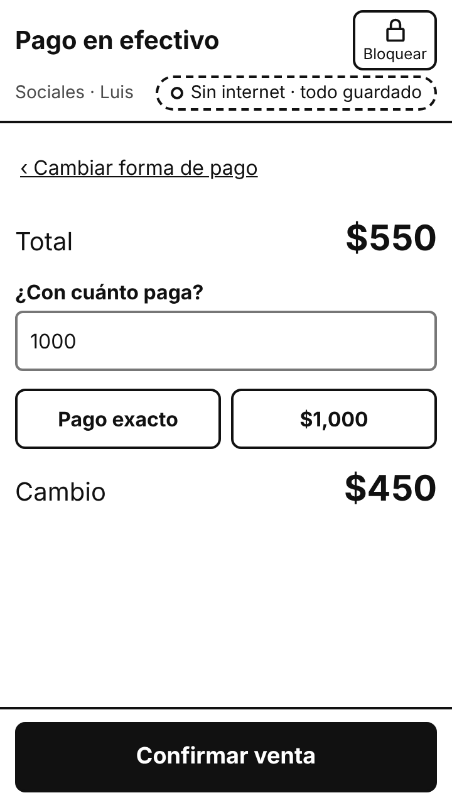 | **SCR-06** 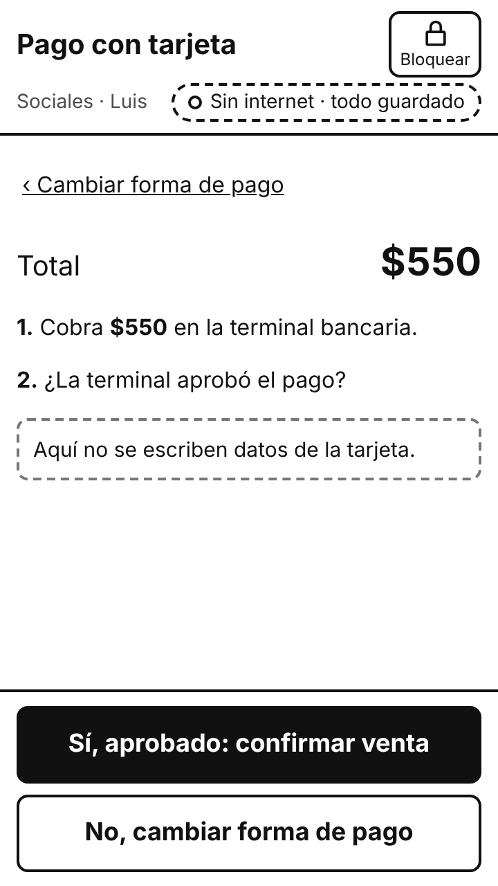 | **SCR-07** ([full](screens/SCR-07-full.png)) 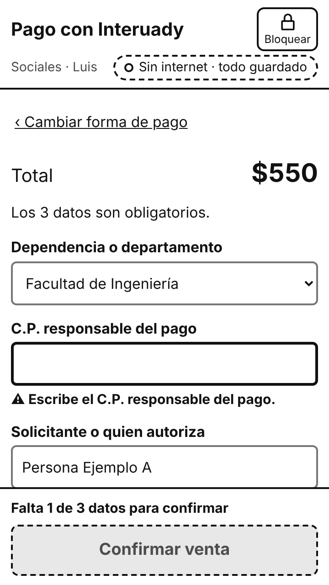 | **SCR-08** 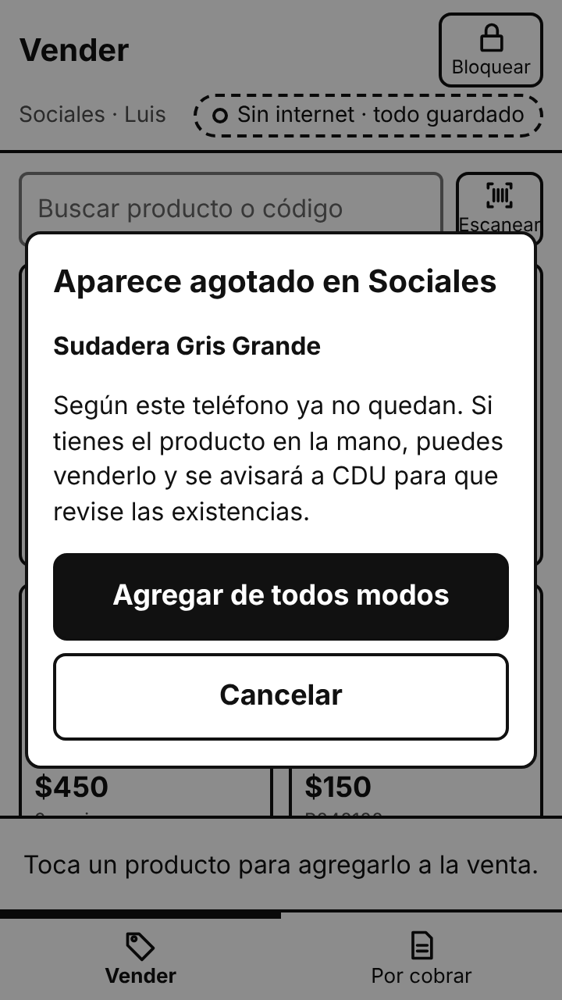 |
| **SCR-09** 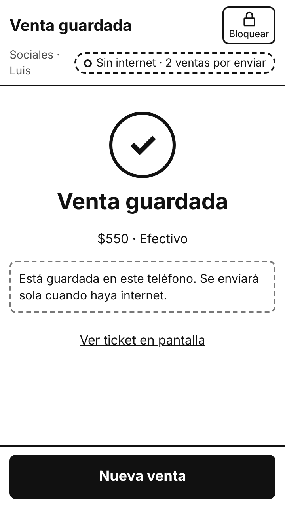 | **SCR-10** 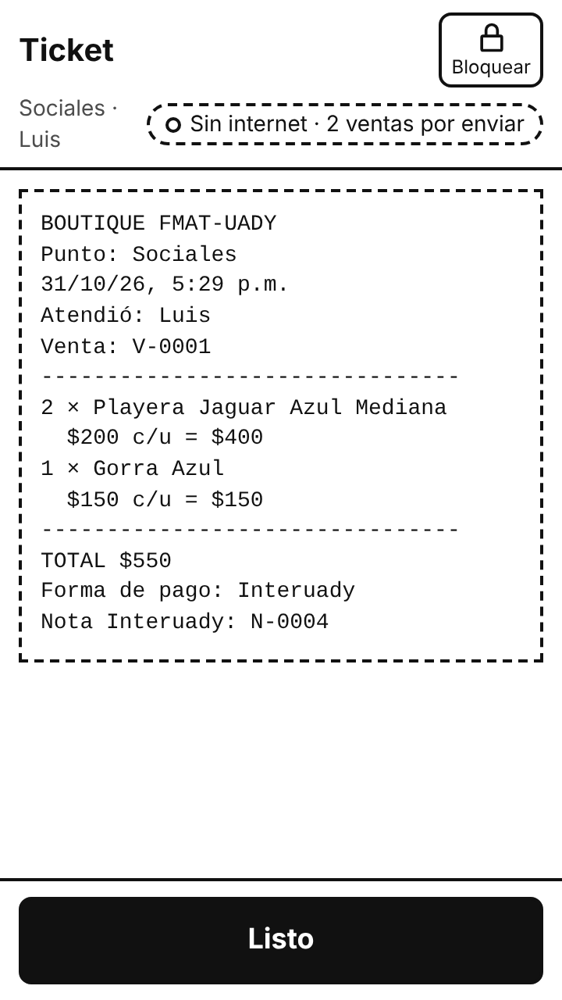 | **SCR-11** 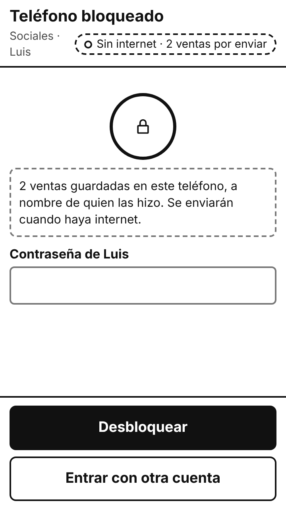 | **SCR-12** ([full](screens/SCR-12-full.png)) 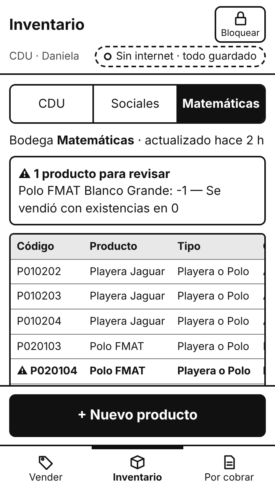 |
| **SCR-13** ([full](screens/SCR-13-full.png)) 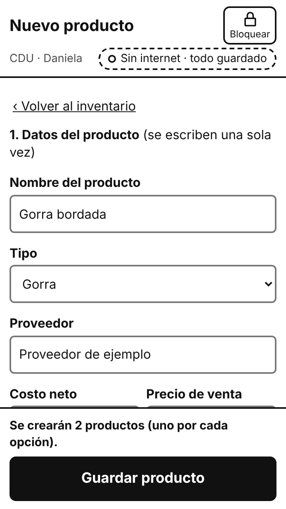 | **SCR-14** ([full](screens/SCR-14-full.png)) 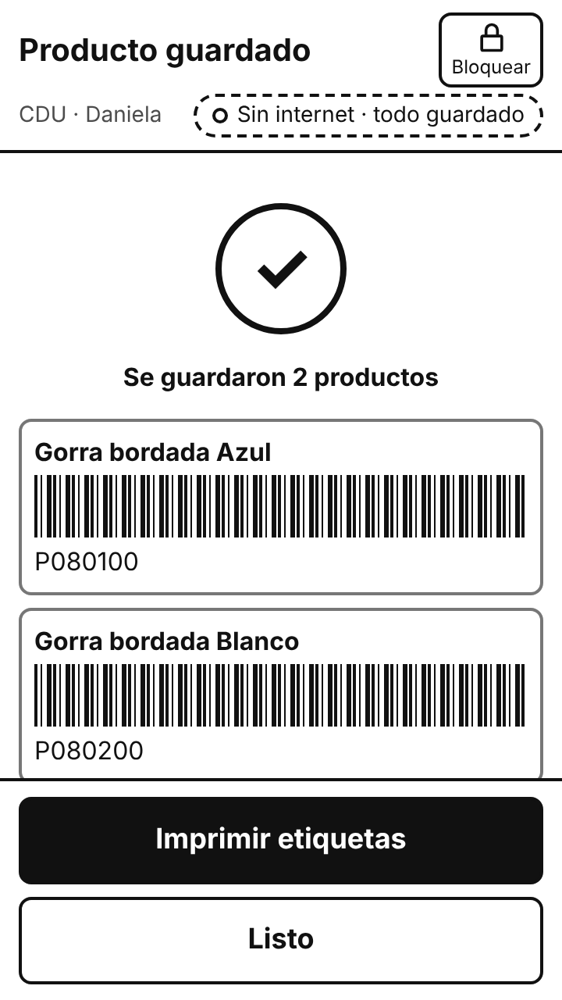 | **SCR-15** 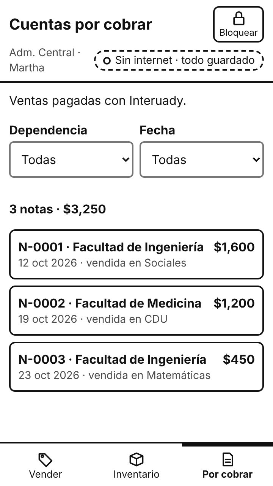 | **SCR-16** 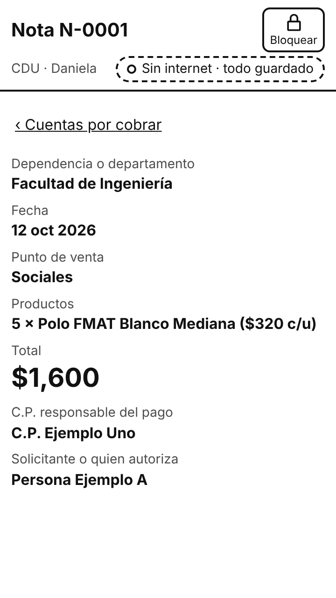 |

## Checks (2026-10-31)

| Check | Result |
|---|---|
| Key flows ([`flows.js`](../../../tools/prototype/flows.js)) | 39 of 39 assertions pass |
| Paths of the usability test tasks ([`tasks.js`](../../../tools/prototype/tasks.js)) | 11 of 11 checks pass |
| Touch targets | 0 interactive elements below 48 px on 16 screens |
| SCR-04 at 360 × 640 with two products | The three payment methods are visible without scrolling |
| Requirements per screen | Same as v1; `tools/trace.py --check` now checks v2 |
