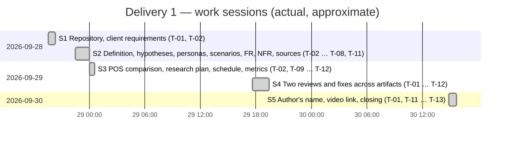

# Schedule

> **Task:** T-10 · **Rubric criterion:** 2 · **Owner of every task:** Alan Pérez (individual project)
>
> Actual dates and times come from the git history and GitHub issues; see the [task log](task-log.md) and [logbook](logbook/).

**How this schedule was built.** The project was assigned on 2026-08-14 (see the [meeting log](meetings.md)); the work recorded in this repository started on 2026-09-28. Tasks T-01…T-13 were registered as issues on 2026-09-28 at 23:26, after work had begun, so the *Planned* dates in §2 were set on that day and are not evidence of earlier planning. §4 records what actually happened.

**Lesson learned for delivery 2.** Compressing delivery 1 into two days confirmed the time risk identified in the [project definition](../01-definition/project-definition.md#43-project-risks). From delivery 2 on, each task is created as an issue with an estimate **before** work starts, and the schedules in §5 and §6 get real dates as soon as each delivery date is announced.

## 1. Project roadmap

| Delivery | Branch | Focus | Due date | Status |
|---|---|---|---|---|
| 1 | `first-delivery` | Project definition, hypothesis-based user modeling (proto-personas), initial requirements, research plan | 2026-09-30 | Delivered (tag `delivery-1`) |
| 2 | `second-delivery` | Requirements evolution, design guidelines, low-fidelity prototype, interaction design, inspection (optional), usability test protocol (V-07 sketch); field research (V-01…V-06) ready but blocked pending the client's permission | 2026-10-31 | In progress |
| 3 | `third-delivery` | Iterated prototype, usability testing, technical tests (V-08) | To be announced | Planned |

## 2. Delivery 1 — activities

| Task | Activity | Artifact | Planned | Actual (commit dates) | Status |
|---|---|---|---|---|---|
| T-01 | Repository structure, README, client requirements | `README.md`, `client/` | 2026-09-28 | 2026-09-28 → 2026-09-30 | Done |
| T-02 | Project definition (relevance, innovation, feasibility) | `docs/01-definition/project-definition.md` | 2026-09-28 | 2026-09-28 → 2026-09-29 | Done |
| T-03 | User hypotheses | `docs/02-research/hypotheses.md` | 2026-09-28 | 2026-09-28 → 2026-09-29 | Done |
| T-04 | Proto-personas | `docs/03-user-modeling/proto-personas.md` | 2026-09-28 | 2026-09-28 → 2026-09-29 | Done |
| T-05 | Scenarios | `docs/03-user-modeling/scenarios.md` | 2026-09-28 | 2026-09-28 → 2026-09-29 | Done |
| T-06 | Functional requirements | `docs/04-requirements/functional-requirements.md` | 2026-09-28 | 2026-09-28 → 2026-09-29 | Done |
| T-07 | Non-functional requirements | `docs/04-requirements/non-functional-requirements.md` | 2026-09-28 | 2026-09-28 → 2026-09-29 | Done |
| T-08 | Traceability matrix | `docs/04-requirements/traceability-matrix.md` | 2026-09-28 | 2026-09-28 → 2026-09-29 | Done |
| T-09 | Research and validation plan + instruments | `docs/02-research/` | 2026-09-28 | 2026-09-29 | Done |
| T-10 | Schedule | `docs/00-management/schedule.md` | 2026-09-29 | 2026-09-29 | Done |
| T-11 | Logbook and task log | `docs/00-management/` | Every session | Every session | Done |
| T-12 | Individual contribution metrics | `docs/00-management/contribution-metrics.md` | 2026-09-29 | 2026-09-29 | Done |
| T-13 | Presentation video | `docs/05-presentation/` | 2026-09-29 | 2026-09-29 → 2026-09-30 | Done |

## 3. Closing steps for delivery 1 (due 2026-09-30)

| # | Step | Task | Status |
|---|---|---|---|
| 1 | Optional: connectivity check at the Matemáticas point (FMAT) with the [checklist](../02-research/instruments/device-connectivity-checklist.md) | T-09 (V-05) | Moved to delivery 2 |
| 2 | Record the video and add its link to `docs/05-presentation/` | T-13 | Done (2026-09-30) |
| 3 | Update logbook and contribution metrics with the final session | T-11, T-12 | Done (2026-09-30) |
| 4 | Merge `first-delivery` into `main` and tag `delivery-1` | T-01 | Done (2026-09-30) |
| 5 | Submit the repository link | — | Author |

## 4. Timeline

Delivery 1 was executed in work sessions (see the [logbook](logbook/)). The time spent recording the video was not logged and is not shown. The chart shows **sessions**, not task durations: several tasks were worked on in the same session, and commit times only mark when work was saved.

## 5. Delivery 2 — plan (due 2026-10-31)

**How this plan was built.** The author provided the delivery 2 rubric ([transcription](../../client/rubric-delivery-2.md)), the due date (2026-10-31) and the video limit (5 minutes) on 2026-10-27. Tasks T-14…T-28 were created as issues with estimated hours on 2026-10-27, **before** work on them started (lesson learned from delivery 1). Estimates are the author's planned working-session hours; actual hours are recorded in each issue and in the [task log](task-log.md) when it closes.

**Change from the delivery 1 plan.** The previous version of this section put field research (V-01…V-06) in weeks 1–2. It is blocked: permission to observe and interview at the boutique was requested from the client on 2026-09-30 and 2026-10-19 and has not been answered ([communications](meetings.md#communications-with-the-client)). The plan therefore starts with the work that does not depend on the client, and leaves fieldwork ready to run (T-15).

| Day | Tasks | Est. (h) |
|---|---|---|
| Tue 2026-10-27 | Issues and milestone; T-14 setup; T-15 starts | 1.0 |
| Wed 2026-10-28 | T-15 field research ready (blocked); T-16 requirements revision; T-17 FR ↔ NFR map; T-19 design guidelines | 6.0 |
| Thu 2026-10-29 | T-20 prototype v1; T-21 interaction design; T-18 requirements → design traceability | 6.0 |
| Fri 2026-10-30 | T-22 inspection *(conditional)*; T-23 prototype v2; T-24 usability test protocol; T-27 contribution metric; T-25 pilot *(conditional)* | 8.5 |
| Sat 2026-10-31 | T-28 video (≤ 5 min) and closing: PR to `main`, tag `delivery-2` | 2.5 |
| Every session | T-26 logbook and task tracking | 1.0 |

Total estimated: **25.0 h**; without the conditional tasks (T-22, T-25): **21.0 h**.

**Checkpoints and cut order.** The author asked for a cut proposal in case the estimates do not fit the date.

| Checkpoint | Condition to go ahead | If not met |
|---|---|---|
| A — Thu 2026-10-29, end of day | Prototype v1 (T-20) reviewed by the author | Cut **T-22**; T-23 iterates v1 on the author's review |
| B — Fri 2026-10-30, 14:00 | Protocol (T-24) and prototype v2 (T-23) finished, and the 2 proxy participants available | Cut **T-25**; the protocol stays ready for a pilot in delivery 3 |
| C — any time | Mandatory tasks at risk | Reduce T-15 to the Spanish versions of V-01 and V-02 only; the rest are prepared when permission arrives |

Cut order: **T-25 → T-22 → T-15 (reduced)**. A cut task is closed as *Cancelled* in the task log, with the reason.

**Progress against this plan**

| Date | Planned | Actual |
|---|---|---|
| Tue 2026-10-27 | Issues, T-14, T-15 | Done as planned; T-15 waits for the author's review of the Spanish versions ([logbook](logbook/2026-10-27.md)) |
| Wed 2026-10-28 | T-15, T-16, T-17, T-19 | **No work session.** The day's tasks moved |
| Thu 2026-10-29 | T-18, T-20, T-21 | T-19 (moved from Wednesday), T-20 (v1, author's review pending), T-18 and T-21 done ([logbook](logbook/2026-10-29.md)). T-16 and T-17 move to Friday |
| Fri 2026-10-30 | T-22, T-23, T-24, T-25, T-27 | Now also T-16 and T-17. Checkpoint A was met (v1 reviewed on 2026-10-29), but the author **cancelled T-22** to make room for T-16 and T-17 |

## 6. Delivery 3 — planned activities (dates to be set when announced)

The final delivery rubric ([original](../../client/originals/Rubric_Final_Delivery-HCI.pdf)) asks for a summary of the changes across the three deliveries, the product by user-centred design phase with the transition between stages and prototypes, the usability tests in detail (materials, evidence, analysis, results), lessons learned, the presentation and teamwork. Delivery 2 artifacts are built so they can be reused: requirement change log, versioned prototypes with an evolution log, and a test protocol that can be run as is.

| Week | Activities | Tasks (to be created) |
|---|---|---|
| 1 | Field research V-01…V-06 when permission is granted; iterate the prototype on its findings and on the delivery 2 pilot, if run | T-29 |
| 2 | Usability test rounds (V-07), including the two-week memorability task (NFR-05) | T-30 |
| 3 | Technical tests on a reference low-end phone: performance, offline, scanner and printer (V-08) | T-31 |
| 4 | Final requirements revision, lessons learned, report and presentation | T-32…T-33 |
